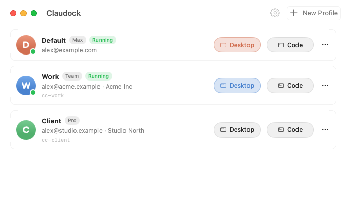
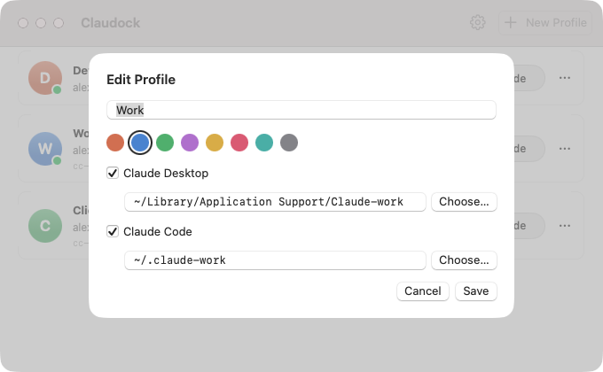
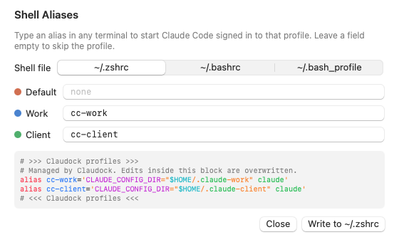
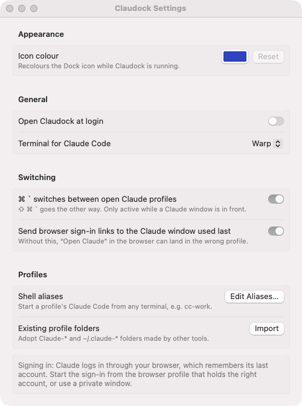

# Claudock

Run several Claude Desktop windows side by side on macOS, each signed in to a different account, and open Claude Code with the matching login from one place.

Claudock is an independent tool. It is not affiliated with or endorsed by Anthropic.



## What it does

- **Profiles.** Each profile has its own Claude Desktop data folder and its own Claude Code config folder, so chats and logins never mix.
- **Several Desktops at once.** Every profile opens as a separate Claude Desktop process. Work, personal and client accounts can all stay open.
- **Claude Code per profile.** Opens `claude` in Terminal, iTerm, Ghostty or Warp with that profile's `CLAUDE_CONFIG_DIR`.
- **Sign-in routing.** Sends the browser's "Open Claude" redirect to the Claude window you used last instead of an arbitrary one.
- **⌘ ` switching.** Cycles between open Claude profiles, which macOS does not do on its own because each is a separate app.
- **Shell aliases.** Writes one alias per profile (for example `cc-work`) into `.zshrc`, `.bashrc` or `.bash_profile`.
- **Menu bar item.** Every profile is one click away without opening the main window.
- **Import.** Adopts existing `Claude-*` and `~/.claude-*` folders in place.

## Requirements

- macOS 14 or later
- [Claude Desktop](https://claude.ai/download) installed
- Claude Code (`claude` on your `PATH`) for the Code features
- Xcode command line tools, to build

## Build and run

```sh
./build.sh
open build/Claudock.app
```

`build.sh` compiles a release build, assembles `build/Claudock.app` and signs it ad hoc. Copy the app to `/Applications` if you want to keep it, especially before enabling "Open at login".

Each rebuild re-signs the app, so macOS may ask again for the Automation permission described below.

## Using it

### Create a profile

1. Click **New Profile**, give it a name and a colour.
2. Choose Claude Desktop, Claude Code, or both.
3. Optionally set the folders yourself. Left empty, they default to
   `~/Library/Application Support/Claude-<name>` and `~/.claude-<name>`.
4. Click **Desktop** on the new card and sign in.



The built-in **Default** profile is your existing setup: the standard Claude Desktop folder and Claude Code run without `CLAUDE_CONFIG_DIR`.

### Signing in

Claude signs in through your browser, and the browser remembers its last account. Start the sign-in from the browser profile that holds the right account, or use a private window.

With several Claude windows open, the redirect back from the browser goes to the Claude window that was in front most recently. Keep the profile you are signing in as the last Claude window you touched. The first time, macOS asks whether Claudock may control Claude; allow it.

### Switching

- **Desktop** on a card opens the profile, or brings it forward if it is already running.
- **⌘ `** and **⇧ ⌘ `** cycle through open profiles in list order. The shortcut is only active while a Claude window is in front and at least two profiles are open.
- Drag cards to reorder them.

### Shell aliases

Settings › Profiles › **Edit Aliases…** writes a managed block to the shell file you pick:

```sh
# >>> Claudock profiles >>>
alias cc-work='CLAUDE_CONFIG_DIR="$HOME/.claude-work" claude'
# <<< Claudock profiles <<<
```



Only that block is touched, and it is rewritten when profiles change. The first write saves a copy of the file next to it with a `.claudock-backup` suffix.

### Settings

Open with ⌘ , or the gear button.



| Setting | Effect |
|---|---|
| Icon colour | Recolours the Dock icon while Claudock is running |
| Open Claudock at login | Starts Claudock in the menu bar at login |
| Terminal for Claude Code | Terminal app used by the **Code** button |
| ⌘ ` switches profiles | Turns the switching shortcut on or off |
| Send browser sign-in links… | Turns sign-in routing on or off |

## How it works

| Feature | Mechanism |
|---|---|
| Separate Desktops | Launches Claude with `--user-data-dir=<folder>` as a new instance |
| Claude Code login | Sets `CLAUDE_CONFIG_DIR=<folder>` for the terminal session and the Desktop process |
| Running state | Reads the process list and matches each Claude process to a profile by its data folder |
| Sign-in routing | Registers as the handler for `claude://` links and forwards each link to the frontmost Claude process |
| ⌘ ` | A global hotkey that is registered only while Claude is frontmost |

Two details worth knowing:

- Claude Desktop re-registers itself for `claude://` every time it starts, so Claudock checks every two seconds and takes the scheme back while routing is enabled.
- Setting `CLAUDE_CONFIG_DIR` changes which login Claude Code uses even when it points at `~/.claude`. Every profile except Default always sets it.

## Files Claudock writes

| Path | Contents |
|---|---|
| `~/Library/Application Support/Claudock/profiles.json` | The profile list |
| `~/Library/Application Support/Claudock/launchers/` | Small scripts used to start Claude Code in a terminal |
| `~/Library/Logs/Claudock.log` | Link routing and shortcut diagnostics (sign-in codes are not logged) |
| Your shell file | The alias block, only after you click Write |

Removing a profile keeps its data unless you choose **Remove and Move Data to Trash**.

## Project layout

```
Sources/Claudock/
  App.swift            Scenes: main window, Settings, menu bar
  MainViews.swift      Profile cards, Settings, menu bar menu
  Views.swift          Profile editor and alias editor
  Store.swift          Profile list, persistence, status polling
  Launcher.swift       Starting and focusing Claude Desktop and Claude Code
  LinkRouter.swift     claude:// handling and app delegate
  WindowCycler.swift   ⌘ ` hotkey
  ShellAliases.swift   Managed alias block in shell files
  IconRenderer.swift   App icon drawing, shared with the icon script
docs/                  README screenshots
Resources/             Info.plist, AppIcon.icns, BurstMask.png
Scripts/make-icns.sh   Regenerates AppIcon.icns
build.sh               Builds build/Claudock.app
```

### Changing the default icon colour

Edit `defaultHex` in `Sources/Claudock/IconRenderer.swift`, then:

```sh
./Scripts/make-icns.sh
./build.sh
```

### Retaking the screenshots

Setting `CLAUDOCK_DEMO` starts the app with sample profiles and touches no real data. Its value picks the screen: `main`, `editor`, `settings` or `aliases`.

```sh
CLAUDOCK_DEMO=main build/Claudock.app/Contents/MacOS/Claudock
```

## Limitations

- macOS only.
- The Dock icon of each running Claude window cannot be changed per profile; all of them use Claude's own icon.
- While the ⌘ ` shortcut is active it replaces window cycling inside a single Claude instance.
- A custom icon colour shows only while Claudock is running. Finder shows the default.
- Updates to Claude Desktop could change how it handles `--user-data-dir` or `claude://` links.

## Troubleshooting

- **"Open Claude" in the browser lands in the wrong window or nowhere.** Make sure Claudock is running and sign-in routing is on, wait a few seconds after opening a profile, then start the sign-in again from that profile's window. Check `~/Library/Logs/Claudock.log`.
- **The redirect does nothing after a rebuild.** Allow Claudock under System Settings › Privacy & Security › Automation.
- **⌘ ` does nothing.** Click a Claude window first; the shortcut needs Claude in front and two or more profiles open.
- **Claude Code opens with the wrong account.** Run `/login` once inside the session started from that profile's **Code** button.

## Trademark note

The icon uses a shape derived from the Claude logo, and the name refers to Claude. Both belong to Anthropic. This is fine for personal use; replace the icon and reconsider the name before distributing the app.
